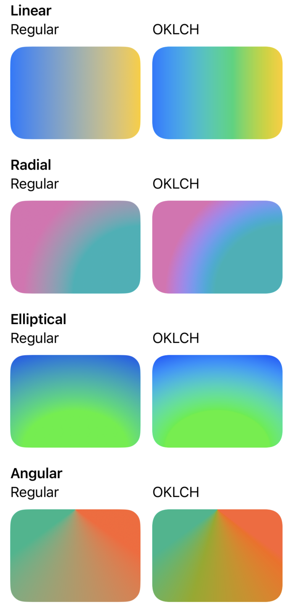

<div align="right">
  <details>
    <summary >🌐 Language</summary>
    <div>
      <div align="center">
        <a href="https://openaitx.github.io/view.html?user=fwrs&project=OKLCHGradient&lang=en">English</a>
        | <a href="https://openaitx.github.io/view.html?user=fwrs&project=OKLCHGradient&lang=zh-CN">简体中文</a>
        | <a href="https://openaitx.github.io/view.html?user=fwrs&project=OKLCHGradient&lang=zh-TW">繁體中文</a>
        | <a href="https://openaitx.github.io/view.html?user=fwrs&project=OKLCHGradient&lang=ja">日本語</a>
        | <a href="https://openaitx.github.io/view.html?user=fwrs&project=OKLCHGradient&lang=ko">한국어</a>
        | <a href="https://openaitx.github.io/view.html?user=fwrs&project=OKLCHGradient&lang=hi">हिन्दी</a>
        | <a href="https://openaitx.github.io/view.html?user=fwrs&project=OKLCHGradient&lang=th">ไทย</a>
        | <a href="https://openaitx.github.io/view.html?user=fwrs&project=OKLCHGradient&lang=fr">Français</a>
        | <a href="https://openaitx.github.io/view.html?user=fwrs&project=OKLCHGradient&lang=de">Deutsch</a>
        | <a href="https://openaitx.github.io/view.html?user=fwrs&project=OKLCHGradient&lang=es">Español</a>
        | <a href="https://openaitx.github.io/view.html?user=fwrs&project=OKLCHGradient&lang=it">Italiano</a>
        | <a href="https://openaitx.github.io/view.html?user=fwrs&project=OKLCHGradient&lang=ru">Русский</a>
        | <a href="https://openaitx.github.io/view.html?user=fwrs&project=OKLCHGradient&lang=pt">Português</a>
        | <a href="https://openaitx.github.io/view.html?user=fwrs&project=OKLCHGradient&lang=nl">Nederlands</a>
        | <a href="https://openaitx.github.io/view.html?user=fwrs&project=OKLCHGradient&lang=pl">Polski</a>
        | <a href="https://openaitx.github.io/view.html?user=fwrs&project=OKLCHGradient&lang=ar">العربية</a>
        | <a href="https://openaitx.github.io/view.html?user=fwrs&project=OKLCHGradient&lang=fa">فارسی</a>
        | <a href="https://openaitx.github.io/view.html?user=fwrs&project=OKLCHGradient&lang=tr">Türkçe</a>
        | <a href="https://openaitx.github.io/view.html?user=fwrs&project=OKLCHGradient&lang=vi">Tiếng Việt</a>
        | <a href="https://openaitx.github.io/view.html?user=fwrs&project=OKLCHGradient&lang=id">Bahasa Indonesia</a>
        | <a href="https://openaitx.github.io/view.html?user=fwrs&project=OKLCHGradient&lang=as">অসমীয়া</
      </div>
    </div>
  </details>
</div>

# OKLCH gradients for SwiftUI

This is a drop-in replacement for SwiftUI's built-in [LinearGradient](https://developer.apple.com/documentation/swiftui/lineargradient), [RadialGradient](https://developer.apple.com/documentation/swiftui/radialgradient), [EllipticalGradient](https://developer.apple.com/documentation/swiftui/ellipticalgradient) and [AngularGradient](https://developer.apple.com/documentation/swiftui/angulargradient) shape styles that utilizes OKLCH color blending to create more visually appealing gradients.

Implemented using iOS 17's [Shader](https://developer.apple.com/documentation/swiftui/shader) API, since that seems to be the only way to write shape styles with custom rendering without relying on private APIs.

Install using SPM:

```swift
dependencies: [
    .package(url: "https://github.com/fwrs/OKLCHGradient.git", .upToNextMajor(from: "1.0.9"))
]
```

To use just prepend `OKLCH` to the gradient struct name:

```swift
// change

Rectangle()
    .background(LinearGradient(
        colors: [.blue, .yellow],
        startPoint: .leading,
        endPoint: .trailing
    ))

// to

import OKLCHGradient

Rectangle()
    .background(OKLCHLinearGradient(
        colors: [.blue, .yellow],
        startPoint: .leading,
        endPoint: .trailing
    ))
```

And enjoy the difference:



> [!NOTE]
> At the moment it's not possible to pass AnyGradient structs to OKLCH gradients because there isn't a way to read color stops from an AnyGradient using public APIs. This functionality is limited to Apple's own built-in gradients.
